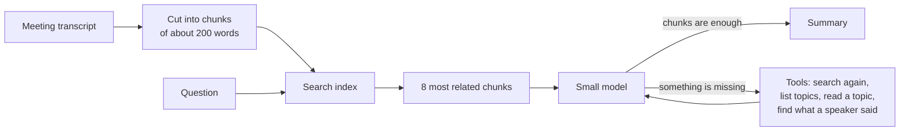
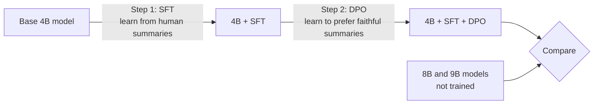

# SmallTalk

**Can Agentic RAG and LoRA-Based DPO Help 4B Models Close the Gap with Larger Models in Meeting Summarization?**

NLP 2 class project, Fanshawe College. Author: Francis Neil Moral.

## The idea in plain words

Small AI models are cheap and can run on a normal laptop, but they usually write worse summaries than bigger models. This project tests whether a small model (4 billion parameters) can get close to a model twice its size if we give it two kinds of help:

1. **Better reading.** A one-hour meeting is too long for the model to read at once. So we give it only the parts of the meeting that relate to the question, and tools to look up more if those parts are not enough.
2. **Extra training.** We train the small model on examples of good meeting summaries, then train it again to prefer summaries that stick to what was actually said.

The task: given a meeting transcript and a question such as "What did the team decide about the budget?", write a short summary that answers it.

## How one question is answered

We compare three ways of answering:

| Mode | What the model gets | In plain words |
|---|---|---|
| `zeroshot` | The first 6,000 tokens of the transcript | Read the start of the meeting and answer |
| `rag` | The 8 most related chunks | Read only the related parts and answer |
| `agent` | The same 8 chunks, plus tools it may call up to 4 times | Read the related parts, then decide if you need to look up more |

RAG means retrieval-augmented generation: search first, then write. "Agentic" means the model itself decides if it needs another search.

## How the small model is trained

- **SFT (supervised fine-tuning):** the model sees a question, the related chunks, and the summary a person wrote. It learns to write in that style.
- **DPO (direct preference optimization):** the trained model writes 4 summaries for the same question. Each one is scored on how well it sticks to the chunks and how close it is to the human summary. The best and the worst become a pair, and the model learns to prefer the best one.
- **LoRA:** we do not retrain the whole model. We train a small add-on (an adapter), which is what makes training possible on a free Colab GPU.

## Models

| Role | Model |
|---|---|
| Small, fine-tuned | Qwen3-4B |
| Bigger, same family | Qwen3-8B |
| Bigger, different family | Ministral 3 8B |

Every model is loaded in 4-bit and answers the same 150 test questions, so the comparison is fair.

A second pair, Qwen3.5-4B and Qwen3.5-9B, is set up in `config.py` but switched off for now. It can be turned on there if time allows.

## Data

[QMSum](https://github.com/Yale-LILY/QMSum) (Zhong et al., NAACL 2021): 232 meetings with 1,810 questions and human-written answers. The meetings are product design meetings, academic meetings and parliament committee meetings. Many questions also mark which part of the transcript holds the answer. We use those marks, called gold spans, to check if the search finds the right chunks.

## How the results are measured

| Measure | What it tells us |
|---|---|
| ROUGE-1/2/L | How many words and phrases match the human summary |
| BERTScore | How close the meaning is to the human summary |
| Faithfulness (HHEM) | Is the summary supported by the text the model read? Under 0.5 counts as a hallucination |
| Hit, Recall, Precision, MRR | Did the search find the chunks that hold the answer? |
| Tool use rate, format errors | How the agent behaved |
| Gap closed | `(tuned 4B - base 4B) / (big model - base 4B)`. 0 means no progress, 1 means the small model caught up |

Two extra checks for the agent:

- **Did tools help?** The agent starts with the same chunks as `rag` mode. So on the questions where it chose to use a tool, we compare its answer with the plain `rag` answer from the same model.
- **Did it know when to use a tool?** For questions with gold spans we know if the starting chunks already held the answer. A model with good judgment should use tools more often when they did not.

## Design choices and why

**Chunks are capped by words, not by speaker turns.** Committee meetings have very long turns. A chunk of "5 turns" could be 100 words in one meeting and 3,000 in another.

**The agent starts with chunks instead of nothing.** If the agent saw no transcript at all, it would have to call a tool every time, and we could never test if it knows when a tool is needed. Starting from the same chunks as `rag` also makes the two modes directly comparable.

**Gold evidence goes into the training prompt first.** During SFT only, we add up to 2 chunks that hold the real answer, in case the search missed them. Without this, the model would be trained to write facts that are not in its prompt, which teaches it to make things up.

The prompt has a token limit, so some chunks often have to be dropped. An earlier version put all chunks in meeting order and cut the end. That meant an answer discussed late in the meeting lost its evidence, which brought back the same problem. Now chunks are added by priority until the limit is reached: gold chunks first, then the searched chunks from most to least related. Only after that are they put back in meeting order. The chunks that get dropped are the least related ones, never the evidence.

Gold chunks are never added at test time. That would be cheating, because a real user does not have them.

**DPO uses different questions than SFT.** 300 training questions are kept aside for DPO only, so the model is not judged on summaries it already memorized.

**Faithfulness is checked against what the model read.** This is fair inside `rag` mode, where every model reads the same chunks. In `agent` mode each model may read extra text through tools, so faithfulness there is read together with ROUGE and BERTScore, which do not depend on what the model read.

## Files

| File | What it does |
|---|---|
| `config.py` | Every setting in one place: models, hyperparameters, prompts, and where to run |
| `requirements.txt` | The libraries to install |
| `smalltalk.py` | All shared code: data loading, chunking, search, tools, the agent, model loading, metrics |
| `1_data_rag_baselines.ipynb` | Data overview, search quality, and base results for every model |
| `2_lora_sft_dpo.ipynb` | SFT and DPO training for one small model at a time |
| `3_final_evaluation.ipynb` | Runs the trained models and builds all tables and charts |

## How to run

Run the notebooks in order: 1, 2 (once per small model, by changing `MODEL_KEY` in `config.py`), then 3. The first cells install the libraries with `pip install -r requirements.txt`.

To change a setting, edit `config.py`, save it, and run the Config cell of the notebook again. The shared code is a `.py` file and not a notebook because all three notebooks need the same functions, and a notebook can't cleanly import code from another notebook.

Nothing is downloaded twice. The dataset and the base models go into one downloads folder (`QMSum/` and `models/` inside it). Each notebook checks that folder first and only downloads what is missing. The fine-tuned adapters are saved in `adapters/`, and notebook 2 skips training when an adapter is already there (set `RETRAIN = True` to train again). The downloads folder is `downloads/` next to the notebooks on the server, and `~/smalltalk_downloads` on a local computer so the large model files stay out of a cloud-synced project folder. On Colab it is `/content/downloads` on the Colab disk, because the models are too large for a free Google Drive. That folder is emptied when the Colab session ends, so models download again in a new session. Results and fine-tuned adapters are still saved on Drive. Set `DOWNLOADS` in `config.py` to use another folder.

`RUN_ON` in `config.py` says where the notebooks run:

| `RUN_ON` | Machine | What changes |
|---|---|---|
| `'colab'` | Google Colab with a T4 GPU | Batch size 4, everything runs |
| `'server'` | Remote GPU server | Batch size 8, everything runs |
| `'local'` | Computer with a small GPU (under 12 GB) | Batch size 1, the 8B/9B models are skipped, training is not recommended |
| `'auto'` | Detects one of the above | Default |

The setting only changes speed and what fits in memory. It never changes an experiment setting, so results from different machines can be combined.

On Colab, put `smalltalk.py`, `config.py` and `requirements.txt` in `MyDrive/smalltalk/`. Results are saved there one line at a time, so after a disconnect you can run the same cell again and it continues where it stopped.

## Status

The code is written and its logic has been tested on a small scale. The full runs on a GPU with the real models are still to be done, so there are no results to report yet.
