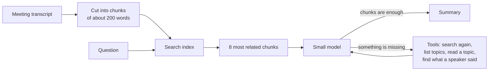
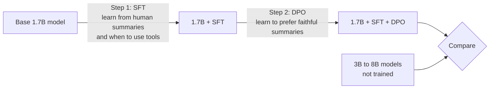

# SmallTalk

**Can Agentic RAG and LoRA Fine-Tuning (SFT + DPO) Help a 1.7B Model Match Larger Models in Meeting Summarization?**

NLP 2 class project, Fanshawe College. Author: Francis Neil Moral.

## The idea in plain words

Small AI models are cheap and can run on a normal laptop, but they usually write worse summaries than bigger models. This project tests whether a small model (1.7 billion parameters) can match models two to five times its size if we give it two kinds of help:

1. **Better reading.** A one-hour meeting is too long for the model to read at once. So we give it only the parts of the meeting that relate to the question, and tools to look up more if those parts are not enough.
2. **Extra training.** We train the small model on examples of good meeting summaries, then train it again to prefer summaries that stick to what was actually said.

The task: given a meeting transcript and a question such as "What did the team decide about the budget?", write a short summary that answers it.

## How one question is answered

We compare three ways of answering:

| Mode | What the model gets | In plain words |
|---|---|---|
| `zeroshot` | The first 6,000 tokens of the transcript | Read the start of the meeting and answer |
| `rag` | The 8 most related chunks | Read only the related parts and answer |
| `agent` | The same 8 chunks, plus tools it may call up to 4 times | Read the related parts, then decide if you need to look up more |

RAG means retrieval-augmented generation: search first, then write. "Agentic" means the model itself decides if it needs another search.

## How the small model is trained

- **SFT (supervised fine-tuning):** the model sees a question, the related chunks, and the summary a person wrote. It learns to write in that style. About a third of the examples are written as agent conversations, so it also learns when to use a tool (see below).
- **DPO (direct preference optimization):** the trained model writes 4 summaries for the same question, one the way it answers at test time and three with some randomness. Each one is scored on how well it sticks to the chunks, how close it is to the human summary in words and in length, and whether it repeats itself. The best and the worst become a pair, and the model learns to prefer the best one.
- **LoRA:** we do not retrain the whole model. We train a small add-on (an adapter) on top of the model loaded in 4-bit (QLoRA), which is what makes training possible on a laptop GPU.

## Models

| Role | Model | Size |
|---|---|---|
| Small, fine-tuned | Qwen3-1.7B | 1.7B |
| Bigger, same family | Qwen3-4B | 4B |
| Bigger, different family | Ministral 3 3B | 3.8B (3.4B language model + vision part, only text is used) |
| Extra reference | Qwen3-8B | 8B |

Every model is loaded in 4-bit and answers the same 150 test questions, so the comparison is fair. None of the bigger models are trained.

## Dataset

[QMSum](https://github.com/Yale-LILY/QMSum) (Zhong et al., NAACL 2021): 232 meetings with 1,810 questions and human-written answers. The meetings are product design meetings, academic meetings and parliament committee meetings. Many questions also mark which part of the transcript holds the answer. We use those marks, called gold spans, to check if the search finds the right chunks.

## How the results are measured

| Measure | What it tells us |
|---|---|
| ROUGE-1/2/L | How many words and phrases match the human summary |
| BERTScore | How close the meaning is to the human summary |
| Faithfulness (HHEM) | Is the summary supported by the text the model read? Under 0.5 counts as a hallucination. The `zeroshot` 6,000-token input needs about 8 GB of GPU memory in HHEM, so those runs were scored separately on a 16 GB cloud GPU |
| Hit, Recall, Precision, MRR | Did the search find the chunks that hold the answer? |
| Loop rate | Share of answers stuck repeating a phrase (under 80% distinct 4-grams) |
| Tool use rate, format errors | How the agent behaved |
| Gap closed | `(tuned small - base small) / (bigger model - base small)`. 0 means no progress, 1 means the small model caught up, above 1 means it passed the bigger model |
| Time | Seconds per answer for every run, and minutes for each training step (SFT data, SFT, DPO candidates, DPO) |
| GPU memory | Peak GPU memory of every run and training step |
| Compute (FLOPs) | Estimated from the tokens each model read and wrote: 2 x parameters x tokens to answer, 6 x for SFT with LoRA, 8 x for DPO |

Two extra checks for the agent:

- **Did tools help?** The agent starts with the same chunks as `rag` mode. So on the questions where it chose to use a tool, we compare its answer with the plain `rag` answer from the same model.
- **Did it know when to use a tool?** For questions with gold spans we know if the starting chunks already held the answer. A model with good judgment should use tools more often when they did not.

## Design choices and why

**A 1.7B model instead of a 4B model.** The project first fine-tuned Qwen3-4B and compared it with Qwen3-8B. Two things changed the plan:

- The first runs showed the base 4B and 8B models were already very close (about 0.01 ROUGE-1 apart). With such a small gap, "gap closed" swings wildly from small changes and says little.
- Training a 4B model and running 8B models needs a 16 GB GPU, and free cloud GPUs kept disconnecting or running out of quota.

Moving one size down keeps the same question. A 1.7B model can be trained and every comparison model can run on a laptop GPU under 12 GB, and the gap to the 4B model is expected to be larger, so it is easier to see how much of it the training closes. The finished 4B and 8B runs are reused: the 4B becomes the same-family bigger model, and the 8B stays as an extra reference.

**Chunks are capped by words, not by speaker turns.** Committee meetings have very long turns. A chunk of "5 turns" could be 100 words in one meeting and 3,000 in another.

**The agent starts with chunks instead of nothing.** If the agent saw no transcript at all, it would have to call a tool every time, and we could never test if it knows when a tool is needed. Starting from the same chunks as `rag` also makes the two modes directly comparable.

**Gold evidence goes into the training prompt first.** During SFT only, we add up to 2 chunks that hold the real answer, in case the search missed them. Without this, the model would be trained to write facts that are not in its prompt, which teaches it to make things up.

The prompt has a token limit, so some chunks often have to be dropped. An earlier version put all chunks in meeting order and cut the end. That meant an answer discussed late in the meeting lost its evidence, which brought back the same problem. Now chunks are added by priority until the limit is reached: gold chunks first, then the searched chunks from most to least related. Only after that are they put back in meeting order. The chunks that get dropped are the least related ones, never the evidence.

Gold chunks are never added at test time. That would be cheating, because a real user does not have them.

**The small model is taught when to use a tool.** In the first runs the base Qwen3-4B model called a tool on only 2% of questions, while Qwen3-8B did on almost half. Smaller models are expected to use tools even less. A small model that never uses its tools gets nothing from agentic RAG, so 30% of the SFT examples are written in the agent format. They are built from the gold spans, with no model involved:

- In half of them the starting excerpts hold the evidence, and the target answer is given right away. This teaches the model not to call tools it does not need.
- In the other half the gold chunks are removed from the starting excerpts on purpose. The target is a tool call that brings them back (checked against the real tool output), followed by the answer. This teaches the model to notice when evidence is missing.

The bigger models are not trained, so this does not change the baselines. The tool checks in notebook 3 show if the trained model uses tools more when its excerpts miss the evidence, and if those answers are better.

**Small differences are tested.** Summary scores between models are often close, so every comparison with the tuned small model gets a 95% interval from a paired bootstrap over the same test questions. A difference only counts if the interval does not include 0.

**Training examples are capped at 3,072 tokens.** This holds a median of 8 chunks plus the answer, the same as at test time. Measured on the longest examples, SFT of the 1.7B model peaks at about 3.4 GB of GPU memory and DPO at about 2.8 GB, so both fit on a small GPU. DPO prompts are cut to the same limit together with the longest possible answer, so the summaries being compared are never cut off.

**Cost is measured, not only quality.** A small model is only worth it if it is also cheaper, so every answer saves its time, its GPU and its token counts, and every training step logs its time, peak GPU memory and tokens to `results/timings.csv`. FLOPs are estimated with the standard rule from Kaplan et al. (2020): a forward pass costs about 2 FLOPs per parameter per token. SFT with LoRA costs about 6, because the gradients still pass back through the frozen model and gradient checkpointing repeats the forward pass. DPO costs about 8, because the frozen reference model adds another forward pass. Loading in 4-bit saves memory but not FLOPs, since the GPU computes in 16-bit. Times are only compared on the same GPU. The Qwen3-4B runs were made on Colab before timing was added, so notebook 1 times a sample of 20 questions again on the local GPU. The 8B reference does not fit on a small GPU, so its time is not reported.

**DPO also fixes repetition loops.** Test answers use greedy decoding (always the most likely next word) so results can be repeated. After SFT, the small model sometimes got stuck repeating a phrase with greedy decoding, in about a quarter of its answers, while no base model did. The first DPO run sampled all 4 candidates with randomness, and sampled answers almost never loop, so DPO never saw the problem. Now one candidate is written greedily, and the score is multiplied by the share of distinct 4-grams, so a loop always ends up as the rejected summary. The DPO learning rate was also raised from 5e-6 to 5e-5, because the lower rate barely changed the LoRA adapter. That run fixed the loops but made answers half the human length, so the score is now also multiplied by the length ratio to the human summary, and the SFT loss on the chosen summary is added to the DPO loss (RPO), which keeps the model close to the good summaries. A repetition penalty at test time was not used, because it would change the answers of every model and the baselines would need to be rerun. See `report_notes.md` for the numbers.

**DPO uses different questions than SFT.** 300 training questions are kept aside for DPO only, so the model is not judged on summaries it already memorized.

**Faithfulness is checked against what the model read.** This is fair inside `rag` mode, where every model reads the same chunks. In `agent` mode each model may read extra text through tools, so faithfulness there is read together with ROUGE and BERTScore, which do not depend on what the model read.

## Files

| File | What it does |
|---|---|
| `config.py` | Every setting in one place: models, hyperparameters, prompts, and where to run |
| `requirements.txt` | The libraries to install |
| `smalltalk.py` | All shared code: data loading, chunking, search, tools, the agent, model loading, metrics |
| `1_data_rag_baselines.ipynb` | Data overview, search quality, and base results for every model |
| `2_lora_sft_dpo.ipynb` | SFT and DPO training for one small model at a time |
| `3_final_evaluation.ipynb` | Runs the trained models and builds all tables and charts |
| `report_notes.md` | Changes made during the project and the reason for each, for the report |
| `runs/` | Every model answer, one jsonl file per run (`<model>_<stage>_<mode>`), with the context it read, its tool calls, time and token counts. `runs/old/` holds the two earlier DPO attempts, described in `report_notes.md` |
| `results/` | Result tables (csv), the main chart, saved faithfulness scores (`faith/`), training logs and the timing log |
| `adapters/` | The final LoRA adapters of the 1.7B model after SFT and after DPO |
| `data/` | The DPO candidates: 4 summaries per DPO question with their faithfulness and ROUGE-L scores |

## How to run

Run the notebooks in order: 1, 2 (once per small model, by changing `MODEL_KEY` in `config.py`), then 3. The first cells install the libraries with `pip install -r requirements.txt`.

To change a setting, edit `config.py`, save it, and run the Config cell of the notebook again. The shared code is a `.py` file and not a notebook because all three notebooks need the same functions, and a notebook can't cleanly import code from another notebook.

Nothing is downloaded twice. The dataset and the base models go into one downloads folder (`QMSum/` and `models/` inside it). Each notebook checks that folder first and only downloads what is missing. The fine-tuned adapters are saved in `adapters/`, and notebook 2 skips training when an adapter is already there (set `RETRAIN = True` to train again). The downloads folder is `downloads/` next to the notebooks on the server, and `~/smalltalk_downloads` on a local computer so the large model files stay out of a cloud-synced project folder. On Colab it is `/content/downloads` on the Colab disk, because the models are too large for a free Google Drive. That folder is emptied when the Colab session ends, so models download again in a new session. Results and fine-tuned adapters are still saved on Drive. Set `DOWNLOADS` in `config.py` to use another folder.

`RUN_ON` in `config.py` says where the notebooks run:

| `RUN_ON` | Machine | What changes |
|---|---|---|
| `'colab'` | Google Colab with a T4 GPU | Batch size 2, everything runs, including the 8B reference |
| `'server'` | Remote GPU server | Batch size 8, everything runs, including the 8B reference |
| `'local'` | Computer with a small GPU (under 12 GB) | Batch size 2, models up to 4B run (the 8B reference is skipped), training runs |
| `'auto'` | Detects one of the above | Default |

The setting only changes speed and what fits in memory. It never changes an experiment setting, so results from different machines can be combined.

On Colab, put `smalltalk.py`, `config.py` and `requirements.txt` in `MyDrive/smalltalk/`. Results are saved there one line at a time, so after a disconnect you can run the same cell again and it continues where it stopped.

## Running it from this repo on another machine

Everything needed is in the repo except the dataset and the base models, which the notebooks download on their own.

1. Clone the repo. On Linux or WSL (native Windows Python does not handle 4-bit loading well), make a Python 3.12 environment and run `pip install -r requirements.txt`.
2. Run the notebooks in order: 1, then 2, then 3. All three notebooks skip work that is already done:
   - **Answers:** a run whose file in `runs/` already has all 150 answers is skipped.
   - **Training:** if the adapter is in `adapters/`, training is skipped.
   - **Faithfulness:** scores saved in `results/faith/` are reused.

   So on a fresh clone, notebook 3 rebuilds every table and the chart in about 15 minutes without generating any answers.
3. To redo something, remove what it produced:
   - **One run:** delete its file in `runs/`.
   - **Training:** set `RETRAIN = True` in `config.py`, or delete the adapter.
   - **DPO pairs:** the candidates are kept in `data/`. Changing the reward only needs notebook 2's pairs and training cells, not new candidates.
4. To add a new test, for example another model, add it to `BIG_MODELS` and `PARAMS_B` in `config.py` and run notebook 1. Only the new runs are generated.

Times in `results/` were measured on one local GPU. They are only comparable with times from the same GPU, so a new machine should time its own runs.

## Status

- Baselines done for every model, SFT done
- All runs done. In agent mode the tuned 1.7B beats Qwen3-4B, Qwen3-8B and Ministral 3 3B on ROUGE-L and faithfulness (all differences significant), with BERTScore level. See `results/` and `report_notes.md`

Search quality on the 130 test questions with gold spans: MRR 0.648, Hit@8 0.915, Recall@8 0.566.

Locally, run the notebooks from WSL (Linux) in a Python environment with `requirements.txt` installed. Native Windows Python does not support `bitsandbytes` 4-bit loading well.
